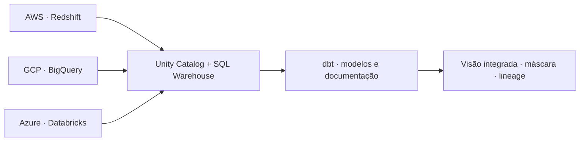

# Criptografia multicloud com Unity Catalog

**POC autoral | Databricks + Azure · Amazon Redshift · BigQuery · dbt**

Este case nasceu de um desafio de integração multicloud da minha trajetória na **Porto**. Para compartilhá-lo publicamente, montei a demonstração **em contas cloud próprias**, com dados de exemplo: criptografia coerente entre três bases, consulta federada pelo Unity Catalog e uma visão integrada no Databricks. Nenhum ambiente ou dado corporativo está publicado aqui.

[**Assista à demonstração na Rescue Point ↗**](https://www.youtube.com/watch?v=LxYPpIu7TEQ) · [**Leia o case completo no meu perfil ↗**](https://github.com/AnselmoBorges/AnselmoBorges/blob/main/cases/multicloud-porto.md)

## O problema técnico

Dados distribuídos entre AWS, GCP e Azure precisam ser correlacionados sem perder o controle de acesso, a rastreabilidade e a coerência da proteção aplicada em cada origem. A POC testa uma abordagem de criptografia nas três plataformas e o uso de catálogos externos para compor consultas no Unity Catalog.

## O que a demonstração cobre

- Preparação de BigQuery, Redshift e Databricks, com o mesmo conjunto de exemplo.
- Funções de criptografia nas origens e projetos dbt para as transformações.
- Camadas Bronze, Silver e Gold, join entre fontes e documentação dbt.
- Mascaramento e lineage na workspace de negócio.

**Federação** pode evitar a replicação persistente prévia de todas as tabelas. Ela ainda movimenta dados durante a execução das consultas; custo, latência, egress e políticas de acesso devem ser avaliados caso a caso. As funções de criptografia desta POC demonstram interoperabilidade e não substituem uma revisão de segurança antes de uso corporativo.

## Vídeo e material

- [Vídeo completo: Criptografia Multicloud com Unity Catalog](https://www.youtube.com/watch?v=LxYPpIu7TEQ)
- Diretórios do experimento: [crypto_unificada](crypto_unificada) e [dbt-env](dbt-env).

---

Anselmo Borges · [GitHub](https://github.com/AnselmoBorges) · [Rescue Point](https://www.youtube.com/@RescuePoint)
